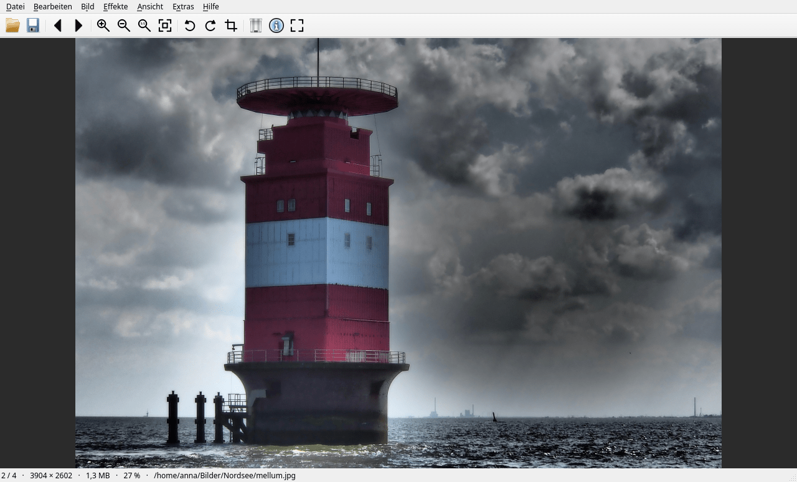
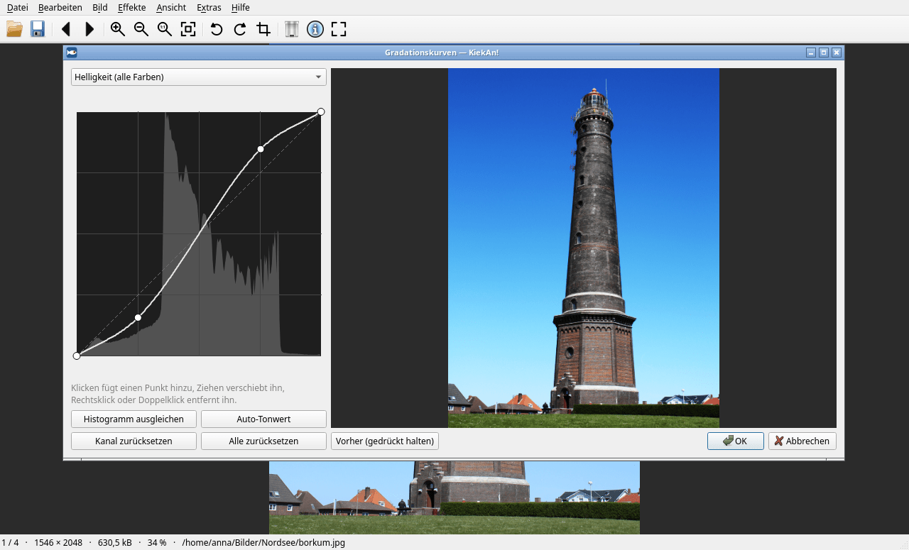
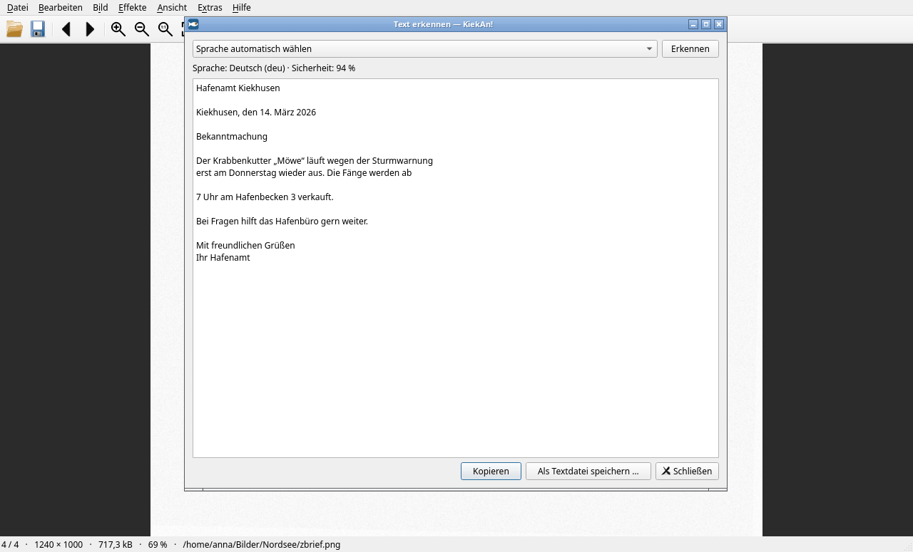
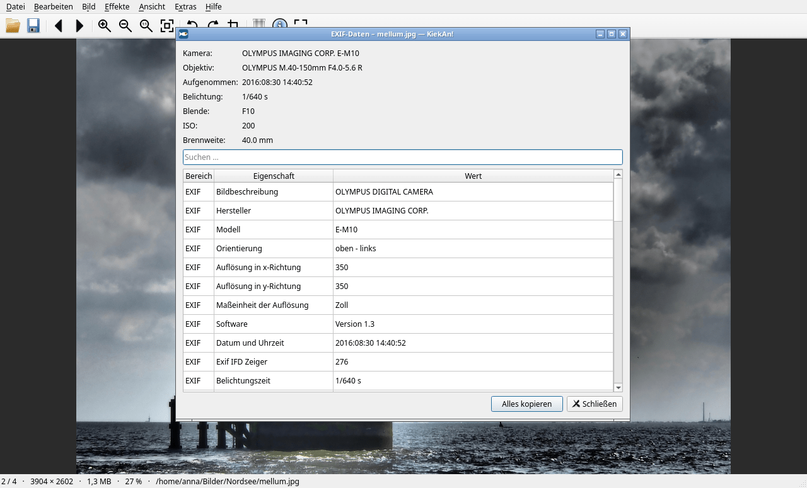

# KiekAn!

**Schneller, schlanker Bildbetrachter mit Bildbearbeitung, Texterkennung und KI-Schnittstelle.**

KiekAn! ist ein schneller Bildbetrachter für Linux, inspiriert von IrfanView. Er
öffnet Bilder ohne Wartezeit, blättert flüssig durch große Ordner und beherrscht
neben den gängigen Formaten auch HEIC, AVIF, Kamera-RAW, JPEG 2000, PSD, DjVu,
PDF und Videos. Für den Alltag bringt er die wichtigen Werkzeuge mit:
Zuschneiden, Drehen, Farben, Gradationskurven, Schärfen, Effekte,
Texterkennung mit automatischer Sprachwahl und das Teilen großer PDFs. Über eine
eingebaute MCP-Schnittstelle können KI-Assistenten wie Claude mit Bildern und
Dokumenten arbeiten.

„KiekAn!“ kommt vom plattdeutschen „Kiek an!“ – „Guck mal an!“.

*English:* KiekAn! is a fast, lightweight image viewer for Linux, inspired by
IrfanView, with editing, OCR with automatic language detection, PDF splitting and
an MCP interface for AI assistants such as Claude. The user interface is
available in German and English.



| Gradationskurven mit Live-Vorschau | Texterkennung | EXIF-Daten |
|---|---|---|
|  |  |  |

## Installation

Fertige Pakete liegen unter [Releases](../../releases). Weil sich die
Bibliotheksversionen der Distributionen unterscheiden, gibt es je System ein
eigenes Paket:

| System | Paket | Installieren |
|---|---|---|
| Ubuntu 24.04, Linux Mint 22, Pop!_OS 24.04 | `kiekan_<version>_ubuntu24.04_<arch>.deb` | `sudo apt install ./kiekan_…deb` |
| Ubuntu 22.04, Linux Mint 21, Pop!_OS 22.04 | `kiekan_<version>_ubuntu22.04_<arch>.deb` | `sudo apt install ./kiekan_…deb` |
| Debian 13 / 12, Raspberry Pi OS (64 Bit) | `kiekan_<version>_debian13_<arch>.deb` / `…_debian12_…` | `sudo apt install ./kiekan_…deb` |
| Fedora 44 / 43 | `kiekan-<version>-1.fc44.<arch>.rpm` / `….fc43…` | `sudo dnf install ./kiekan-…rpm` |
| openSUSE Tumbleweed / Leap 16 | `kiekan-<version>-1.opensuse.<arch>.rpm` / `….leap16…` | `sudo zypper install ./kiekan-…rpm` |
| Arch Linux, Manjaro | [`packaging/arch/PKGBUILD`](packaging/arch/PKGBUILD) | `makepkg -si` |
| Gentoo | [`packaging/gentoo`](packaging/gentoo) (Ebuild) | in ein lokales Overlay kopieren |
| NixOS, Nix | [`packaging/nix`](packaging/nix) | `nix-build packaging/nix` |
| macOS 13+ (Apple Silicon) | `KiekAn-<version>-macos-arm64.dmg` | siehe unten |
| alle anderen (Flatpak) | [`packaging/flatpak`](packaging/flatpak) | siehe unten |

`<arch>` ist `amd64`/`x86_64` für übliche PCs und `arm64`/`aarch64` für ARM-Rechner
wie den Raspberry Pi 4/5 oder ARM-Laptops.

### Mit einem Befehl installieren

Die Befehle laden jeweils die **neueste** Version für das eigene System und den
eigenen Prozessor herunter und installieren sie. Für ein Update einfach erneut
ausführen.

Ubuntu 24.04, Linux Mint 22, Pop!_OS 24.04:

```bash
wget -qO- https://api.github.com/repos/Codatus/kiekan/releases/latest | grep -o "https://[^\"]*_ubuntu24\.04_$(dpkg --print-architecture)\.deb" | wget -qi - -O /tmp/kiekan.deb && sudo apt install /tmp/kiekan.deb
```

Ubuntu 22.04, Linux Mint 21, Pop!_OS 22.04:

```bash
wget -qO- https://api.github.com/repos/Codatus/kiekan/releases/latest | grep -o "https://[^\"]*_ubuntu22\.04_$(dpkg --print-architecture)\.deb" | wget -qi - -O /tmp/kiekan.deb && sudo apt install /tmp/kiekan.deb
```

Debian 13 (für Debian 12 `debian13` durch `debian12` ersetzen), Raspberry Pi OS:

```bash
wget -qO- https://api.github.com/repos/Codatus/kiekan/releases/latest | grep -o "https://[^\"]*_debian13_$(dpkg --print-architecture)\.deb" | wget -qi - -O /tmp/kiekan.deb && sudo apt install /tmp/kiekan.deb
```

Fedora 43/44:

```bash
sudo dnf install "$(curl -s https://api.github.com/repos/Codatus/kiekan/releases/latest | grep -o "https://[^\"]*\.fc$(rpm -E %fedora)\.$(uname -m)\.rpm")"
```

openSUSE Tumbleweed (für Leap 16 `opensuse` durch `leap16` ersetzen):

```bash
sudo zypper install "$(curl -s https://api.github.com/repos/Codatus/kiekan/releases/latest | grep -o "https://[^\"]*\.opensuse\.$(uname -m)\.rpm")"
```

Arch Linux, Manjaro:

```bash
git clone --depth 1 https://github.com/Codatus/kiekan /tmp/kiekan && cd /tmp/kiekan/packaging/arch && makepkg -si
```

macOS (Apple Silicon), danach das Programm in den Programme-Ordner ziehen:

```bash
curl -L -o /tmp/KiekAn.dmg "$(curl -s https://api.github.com/repos/Codatus/kiekan/releases/latest | grep -o 'https://[^"]*\.dmg')" && open /tmp/KiekAn.dmg
```

**Wayland:** KiekAn! läuft unter X11 und unter Wayland (GNOME, KDE Plasma,
LXQt mit labwc …). Für die direkte Wayland-Darstellung braucht Qt sein
Wayland-Modul (`qt6-wayland`); die Pakete schlagen es zur Installation vor.
Fehlt es, läuft KiekAn! über XWayland.

**macOS:** Das Programm ist nicht bei Apple beglaubigt (dafür wäre ein
kostenpflichtiges Entwicklerkonto nötig). Beim ersten Start meldet macOS deshalb
einen „nicht verifizierten Entwickler“: KiekAn! in den Programme-Ordner ziehen,
dann Rechtsklick → „Öffnen“ → „Öffnen“ bestätigen. Danach startet es normal.

HEIC-Fotos (iPhone) brauchen einen HEVC-Decoder, den Fedora und openSUSE aus
Patentgründen nicht mitliefern: unter Fedora `libheif-freeworld` aus
[RPM Fusion](https://rpmfusion.org), unter openSUSE die Codecs aus Packman.
Das Flatpak bringt alles selbst mit.

**Flatpak** (bis zur Aufnahme in Flathub selbst bauen):

```bash
flatpak-builder --user --install --install-deps-from=flathub --force-clean build-flatpak packaging/flatpak/io.github.codatus.kiekan.yml
flatpak run io.github.codatus.kiekan
```

Für Windows 10/11 gibt es ein portables ZIP (`KiekAn-<version>-windows-x64.zip`):
entpacken und `kiekan.exe` starten – ohne Installation. Es enthält alle
Bibliotheken und die Tesseract-Sprachdaten für Deutsch, Englisch und Fraktur.

## Bilder per Doppelklick mit KiekAn! öffnen

**In KiekAn!:** Einstellungen (Taste `P`) → Reiter „Dateizuordnung“. Dort
ankreuzen, welche Dateitypen KiekAn! öffnen soll, und „Zuordnung übernehmen“
klicken. Vorausgewählt sind Bilder und Kamera-RAW; **PDF-Dokumente und Videos
sind nicht angekreuzt** und bleiben bei ihren bisherigen Programmen, solange
Sie sie nicht ausdrücklich wählen. Ein entfernter Haken gibt den Dateityp an
die Vorgabe des Systems zurück. Geändert wird nur Ihre eigene
`~/.config/mimeapps.list` (bei LXQt, KDE usw. zusätzlich eine vorhandene
`<desktop>-mimeapps.list`).

Unter **„Erweiterte Einstellungen …“** lässt sich jeder Dateityp einzeln
festlegen, etwa nur HEIC und JPEG, aber nicht PNG. Jede Zeile nennt die
Dateiendungen und das Programm, das den Typ derzeit öffnet; ein Suchfeld hilft
beim Finden. Ist eine Gruppe nur teilweise gewählt, zeigt der Reiter das mit
einem halben Haken, und „Zuordnung übernehmen“ lässt diese Gruppe unverändert.

**Von Hand:** Im Dateimanager Rechtsklick auf ein Bild → „Öffnen mit“ →
KiekAn! wählen und „als Standard“ bzw. „immer verwenden“ ankreuzen – das gilt
für diesen einen Dateityp. Im Terminal für mehrere Typen auf einmal:

```bash
xdg-mime default kiekan.desktop image/jpeg image/png image/gif image/webp image/tiff image/heic image/avif
```

Beim Flatpak heißt die Desktop-Datei `io.github.codatus.kiekan.desktop`.

**Windows:** Rechtsklick auf ein Bild → „Öffnen mit“ → „Andere App auswählen“
→ `kiekan.exe` suchen und „Immer diese App verwenden“ ankreuzen. Windows lässt
Programme diese Einstellung nicht selbst ändern; der Reiter „Dateizuordnung“
öffnet deshalb nur die Windows-Einstellungen „Standard-Apps“.

## Funktionen

- Bilder sofort anzeigen, Ordner per Tastatur oder Mausrad durchblättern
- Vorladen der Nachbarbilder im Hintergrund, damit das Blättern ohne Wartezeit läuft
- Zoom, Originalgröße, An-Fenster-Anpassen, Vollbild
- Drehen, Spiegeln, Zuschneiden, Größe ändern, Rückgängig
- JPEGs werden **verlustfrei** gedreht und gespiegelt: Beim Speichern ordnet
  KiekAn! die komprimierten Bildblöcke um (libjpeg-turbo), statt neu zu kodieren;
  passen die Maße nicht dazu, ändert es nur die EXIF-Ausrichtung
- **Stapelverarbeitung** (Taste B): viele Bilder umwandeln (Format, Qualität,
  Verkleinern, Farbkorrektur, Graustufen, Metadaten) und **umbenennen** nach
  Muster mit Vorschau, Konfliktprüfung und Rücknahme
- **Diashow** (Taste W) mit einstellbarer Anzeigedauer, Pause mit der Leertaste
- **Drucken** (Strg+P) mit Druckvorschau, an die Seite angepasst
- **Tastenkürzel frei belegen** (Extras → Tastenkürzel anpassen)
- Bilder aus der Zwischenablage einfügen und als Datei speichern
- Speichern als PNG, JPEG, WebP, BMP, TIFF
- Umbenennen, in den Papierkorb verschieben, Bildinformationen
- Histogramm (RGB, Helligkeit, logarithmisch, Kennwerte)
- Gradationskurven mit Histogramm im Hintergrund, Histogrammausgleich als
  bearbeitbare Kurve, Auto-Tonwert
- Graustufen, Schwarzweiß (mit Rasterung), Negativ, automatische Farbkorrektur
- Farben anpassen: Helligkeit, Kontrast, Gamma, Sättigung, Farbton, Rot/Grün/Blau
- Schärfen (Unscharf maskieren), Weichzeichnen
- Effekte: Sepia, Relief, Kanten, Posterisieren, Verpixeln, Vignette, Rauschen
- Alle Korrekturen mit Live-Vorschau; mit Auswahl wirken sie nur auf den markierten Bereich
- Filter-Plugins (siehe unten)
- Deutsch und Englisch, automatisches Drehen nach EXIF abschaltbar
- Videos (über libmpv) mit Bedienleiste; im Vollbild erscheint sie bei Mausbewegung
  über dem Bild (Zeitleiste mit Zielzeit beim Überfahren, Klick springt dorthin);
  Einzelbilder kopieren und speichern
- PDF-Seiten (über QtPdf) und mehrseitige TIFFs seitenweise blättern
- Animierte GIF/WebP werden abgespielt
- EXIF/IPTC/XMP anzeigen (mit Suche und Kartenlink bei GPS); beim Speichern
  bleiben die Metadaten erhalten

- Texterkennung (OCR, Strg+T) mit automatischer Wahl des Sprachpakets und
  Aufrichten gedrehter Seiten; PDFs mit Textebene werden direkt gelesen
- Texterkennung läuft wie bei ocrmypdf in einfädigen Tesseract-Hilfsprozessen,
  mehrere Seiten parallel (Anzahl in den Einstellungen)
- PDFs teilen (Datei → PDF teilen) nach Größe, Seitenzahl oder Bereichen, bevorzugt
  an Lesezeichen; Teile zeigen die Originalseitenzahlen, Teilungsprotokoll als JSON
  und Markdown; beim Ansehen eines Teils nennt die Statuszeile die Originalseite
- Zusätzliche Bildformate als eigene Plugins: PSD/PSB, HEIC/HEIF, AVIF, Kamera-RAW
  (CR2, CR3, NEF, ARW, RAF, RW2, DNG, ORF, PEF …), JPEG 2000, DjVu (mehrseitig)
- Kamera-RAW: beim Blättern die eingebettete Vorschau (Sekundenbruchteile),
  volle Entwicklung im Hintergrund beim Hineinzoomen oder mit Strg+D;
  Bearbeiten und Konvertieren über die KI-Schnittstelle entwickeln immer voll
- EXIF auch dort, wo exiv2 das Format nicht kennt: HEIC/AVIF (EXIF-Block über
  libheif) und z. B. Canon CR3 (Aufnahmedaten über LibRaw)
- Titel, Beschreibung, Stichwörter und Bewertung anzeigen (Bildinformationen)
- Schnittstelle für KI-Assistenten (MCP), siehe unten


## Tastenkürzel

| Taste | Funktion |
|---|---|
| Leertaste, Bild ab, → | Nächstes Bild |
| Rücktaste, Bild auf, ← | Vorheriges Bild |
| Pos1 / Ende | Erstes / letztes Bild |
| Mausrad | Blättern |
| Strg + Mausrad, + / − | Zoomen |
| Strg+H | Originalgröße (100 %) |
| F | An Fenster anpassen |
| Eingabe, F11, Doppelklick | Vollbild |
| Esc | Vollbild beenden / Auswahl aufheben / Beenden |
| Linke Maustaste ziehen | Bereich auswählen |
| Rechte Maustaste ziehen | Verschieben (wenn gezoomt) |
| Strg+Y | Auf Auswahl zuschneiden |
| Strg+C / Strg+V | Kopieren / Einfügen |
| R / L | Rechts / links drehen |
| H / V | Horizontal / vertikal spiegeln |
| Strg+R | Größe ändern |
| Strg+Z | Rückgängig |
| Strg+G | Graustufen |
| Strg+Umschalt+B | Schwarzweiß |
| Strg+Umschalt+N | Negativ |
| Umschalt+U | Automatische Farbkorrektur |
| Strg+Umschalt+E | Histogramm ausgleichen |
| Umschalt+G | Farben anpassen |
| Strg+M | Gradationskurven |
| Umschalt+S | Schärfen |
| Strg+E | Effekte-Browser |
| Umschalt+H | Histogramm anzeigen |
| P | Einstellungen |
| O | Öffnen |
| Strg+S / S | Speichern / Speichern unter |
| B | Stapelverarbeitung (Umwandeln, Umbenennen) |
| W | Diashow (Leertaste: Pause, Esc: Ende) |
| Strg+P | Drucken |
| F2 | Umbenennen |
| Entf | In den Papierkorb |
| I | Bildinformationen |
| Strg+T | Text erkennen (OCR), mit Auswahl nur im markierten Bereich |
| Strg+D | Kamera-RAW voll entwickeln |
| E | EXIF-Daten |
| Strg+Bild ab / Strg+Bild auf | Nächste / vorherige Seite (PDF, TIFF) |
| Leertaste (Video) | Abspielen / Pause |
| → / ← (Video) | 5 s vor / zurück, mit Umschalt 60 s (blättern mit ↑ / ↓) |
| M (Video) | Ton aus / an |
| Strg+C (Video) | Aktuelles Videobild kopieren |
| F1 | Tastenkürzel anzeigen |

Alle Tasten lassen sich unter Extras → Tastenkürzel anpassen ändern; F1 zeigt
immer die aktuelle Belegung.

## Andere Systeme (Windows, weitere Distributionen)

KiekAn! hängt nur von Bibliotheken ab, nicht von externen Programmen (auch
nicht von exiftool – Metadaten liest und schreibt die Bibliothek exiv2).
Alle Bausteine sind optional und auch unter Windows (MSYS2/vcpkg) verfügbar:
Qt 6, libmpv, exiv2, Tesseract, qpdf, libheif, LibRaw, OpenJPEG, DjVuLibre.

Damit es überall gleich funktioniert:

- exiv2 0.27 und 0.28, libmpv 1 und 2, Tesseract 4 und 5, qpdf 10 und 11 werden
  unterstützt.
- Metadaten werden über Qt gelesen/geschrieben und von exiv2 nur im Speicher
  bearbeitet – keine Probleme mit Umlauten oder Windows-Pfaden; Speichern ist
  atomar.
- Ohne Icon-Thema (Windows, schlanke Desktops) nutzt KiekAn! Standard-Icons des
  Qt-Stils bzw. selbst gezeichnete (`KIEKAN_ICON_THEME=none` zum Ausprobieren).
- Tesseract-Sprachdaten in `<Programmordner>/tessdata` werden automatisch
  verwendet (für eine Windows-Installation oder portable Fassung).
- Bildformat-Plugins liegen in `<Programmordner>/qtplugins/imageformats` bzw.
  `lib/kiekan/qtplugins/imageformats`.

## Bauen

Benötigt: CMake ≥ 3.16, einen C++17-Compiler und Qt ≥ 6.2.

Ubuntu/Debian:

```bash
sudo apt install cmake g++ ninja-build qt6-base-dev qt6-base-dev-tools qt6-l10n-tools libqt6svg6-dev libqt6opengl6-dev qt6-image-formats-plugins qt6-translations-l10n \
    libmpv-dev libexiv2-dev qt6-pdf-dev libtesseract-dev libqpdf-dev libheif-dev libraw-dev libopenjp2-7-dev libdjvulibre-dev libturbojpeg0-dev tesseract-ocr-deu tesseract-ocr-eng tesseract-ocr-osd
cmake -S . -B build -G Ninja
cmake --build build
./build/kiekan
ctest --test-dir build
```

Video, EXIF und PDF sind optional (`-DKIEKAN_WITH_VIDEO=OFF` usw.); fehlt eine
Bibliothek, wird ohne die Funktion gebaut.

Fedora:

```bash
sudo dnf install cmake gcc-c++ ninja-build rpm-build qt6-qtbase-devel qt6-qtsvg-devel qt6-qttools-devel qt6-qtimageformats qt6-qtpdf-devel \
    mpv-devel exiv2-devel tesseract-devel leptonica-devel qpdf-devel libheif-devel LibRaw-devel openjpeg2-devel djvulibre-devel turbojpeg-devel tesseract-langpack-deu
```

openSUSE Tumbleweed:

```bash
sudo zypper install cmake gcc-c++ ninja rpm-build qt6-base-devel qt6-svg-devel qt6-tools-linguist qt6-linguist-devel qt6-imageformats qt6-pdf-devel qt6-opengl-devel \
    mpv-devel libexiv2-devel tesseract-ocr-devel leptonica-devel qpdf-devel libheif-devel libraw-devel openjpeg2-devel libdjvulibre-devel 'pkgconfig(libturbojpeg)' tesseract-ocr-traineddata-deu
```

Arch Linux: siehe [`packaging/arch/PKGBUILD`](packaging/arch/PKGBUILD).

Paket erzeugen (mit `-DCMAKE_INSTALL_PREFIX=/usr` konfigurieren):

```bash
cd build && cpack -G DEB    # Debian, Ubuntu, Mint, Pop!_OS
cd build && cpack -G RPM    # Fedora, openSUSE
```

## KI-Schnittstelle (MCP)

Mit `kiekan --mcp` arbeitet KiekAn! als MCP-Server (Model Context Protocol)
über stdin/stdout. Assistenten wie Claude können damit Bilder ansehen,
untersuchen, bearbeiten und konvertieren – und mit dem offenen KiekAn!-Fenster
zusammenarbeiten.

Einbinden in Claude Code:

```bash
claude mcp add --scope user kiekan -- /usr/bin/kiekan --mcp
```

Claude Desktop (`claude_desktop_config.json`):

```json
{ "mcpServers": { "kiekan": { "command": "/usr/bin/kiekan", "args": ["--mcp"] } } }
```

Beim Flatpak lautet der Befehl `flatpak run io.github.codatus.kiekan --mcp`
(in Claude Desktop: `"command": "flatpak", "args": ["run", "io.github.codatus.kiekan", "--mcp"]`).
Das KI-Protokoll liegt dann unter `~/.var/app/io.github.codatus.kiekan/data/kiekan/kiekan/`.

| Werkzeug | Zweck |
|---|---|
| `list_media` | Bilder, PDFs, Videos eines Ordners mit Maßen und Größe |
| `image_info` | Format, Maße, Seiten, EXIF-Zusammenfassung inkl. GPS |
| `view_image` | Vorschau oder Ausschnitt in voller Auflösung, optional mit Koordinatengitter |
| `read_metadata` | alle EXIF/IPTC/XMP-Einträge, filterbar |
| `histogram` | Tonwert-Kennzahlen je Kanal, Anteil abgeschnittener Lichter/Schatten |
| `list_filters` | verfügbare Filter (inkl. Plugins) mit Parametern |
| `edit_image` | Kette aus Drehen, Spiegeln, Zuschneiden, Größe, Kurven, Filtern → neue Datei |
| `convert_batch` | viele Dateien/ganzen Ordner umwandeln, verkleinern, bearbeiten |
| `viewer_show` | Datei im Fenster öffnen (startet KiekAn! bei Bedarf) |
| `viewer_state` | was der Benutzer gerade sieht, inkl. markiertem Bereich |
| `viewer_get_image` | angezeigtes Bild bzw. markierten Bereich, auch mit ungespeicherten Änderungen |
| `viewer_select` | einen Bereich im Fenster markieren, um darauf zu zeigen |
| `viewer_apply` | Bearbeitung als **ungespeicherten Vorschlag** im Fenster zeigen (Strg+S / Strg+Z) |
| `contact_sheet` | viele Bilder nummeriert auf einem Blatt – zum Sichten ganzer Ordner |
| `extract_text` | Text aus PDF-Textebene oder per OCR, Sprache automatisch, optional mit Wortrahmen |
| `ocr_languages` | installierte OCR-Sprachpakete und wie man weitere installiert |
| `write_metadata` | Titel, Beschreibung, Stichwörter, Bewertung in die Datei schreiben (XMP/IPTC/EXIF) |
| `split_pdf` | große PDFs in dokumentierte Teile zerlegen (z. B. unter 30 MB für Claude) |
| `pdf_parts` | Teile einer Teilung auflisten, Originalseite → Teil nachschlagen, Teile prüfen |

### Sicherheit: Freigaben, Prompt Injection, Protokoll

Eine KI liest über KiekAn! fremde Dateien. Text darin – Texterkennung,
PDF-Text, Metadaten, Dateinamen – kann Anweisungen an die KI enthalten
(„Prompt Injection“). KiekAn! begrenzt deshalb, was eine KI tun kann:

- **Ordnerfreigaben** (Extras → Einstellungen → KI-Schnittstelle): Die KI liest
  nur in freigegebenen *Leseordnern* und speichert nur in *Schreibordnern*
  (die sie auch lesen darf). Ohne Freigabe hat sie keinen Dateizugriff bzw.
  darf nichts speichern. Üblich ist ein eigener, leerer Unterordner eines
  Leseordners zum Schreiben. Liegen Leseordner selbst im Schreibbereich, weist
  der Dialog darauf hin. Symlinks, die aus den Freigaben hinausführen, werden
  nicht verfolgt – weder beim Lesen noch beim Schreiben.
- **Ausnahme: das offene Fenster.** Beim ersten Start fragt KiekAn!, ob
  KI-Assistenten das offene Fenster nutzen dürfen; vorgeschlagen ist „aus“.
  Solange „KI-Assistenten dürfen das offene Fenster abfragen und steuern“
  eingeschaltet ist, sieht die KI über `viewer_state` und
  `viewer_get_image` das Bild, das gerade im Fenster angezeigt wird – auch
  außerhalb der Leseordner. Das KI-Protokoll verzeichnet jeden solchen Zugriff.
  Ändern lässt sich das jederzeit in den Einstellungen.
- **Nichts Vorhandenes ändern**, solange „KI darf vorhandene Dateien ersetzen
  und Metadaten ändern“ aus ist: kein `overwrite=true`, kein `write_metadata`.
- **Werkzeug-Kennzeichnung**: Jedes Werkzeug meldet per MCP, ob es nur liest
  (`readOnlyHint`) oder Dateien verändern kann (`destructiveHint`). Claude
  Desktop kann für Letztere nachfragen – dort für KiekAn! die schreibenden
  Werkzeuge auf „Immer fragen“ lassen.
- **Fremden Text kennzeichnen**: Text aus Dateien steht zwischen
  `<<<FILE-CONTENT …>>>`-Markierungen mit zufälliger Kennung; die KI erhält
  die Anweisung, ihn nur als Daten zu behandeln.
- **Verdächtiges melden**: KiekAn! sucht nach typischen Mustern (deutsch und
  englisch: „ignoriere alle bisherigen Anweisungen“, Rollenwechsel,
  Chat-Steuerzeichen, Aufforderungen zu Werkzeugaufrufen oder zum Versenden
  von Daten) sowie nach unsichtbaren Zeichen und verstecktem Unicode-Tag-Text.
  Funde stehen als `SECURITY NOTICE` vor dem Ergebnis, im Protokoll und – wenn
  KiekAn! offen ist – in einem Hinweisfenster.
- **Vertrauenswürdige Ordner**: Unter den Leseordnern lassen sich die
  ankreuzen, die nur eigene Dateien enthalten. Dort warnt KiekAn! nicht bei
  verdächtigem Text (Funde stehen nur grau im Protokoll); Kennzeichnung,
  Protokoll und Rechte bleiben. Dateien, die die KI in Schreibordnern ablegt,
  gelten nur dann als vertrauenswürdig, wenn sie nachweislich aus einem
  vertrauenswürdigen Ordner stammen, seitdem unverändert sind und die KI keine
  eigenen Metadaten hineingeschrieben hat (Herkunftsregister
  `ki-herkunft.json` im Datenordner). So kann eingeschleuster Text aus fremden
  Dateien nicht über eine KI-Kopie „vertrauenswürdig“ werden. Für Download-,
  Temp- und Mail-Ordner rät der Dialog ab.
- **KI-Protokoll** (Extras → KI-Protokoll): jeder Werkzeugaufruf mit Zeit,
  Programm, gelesenen und geschriebenen Dateien und Warnungen; Datei
  `ki-protokoll.jsonl` im Datenordner von KiekAn!

Das senkt das Risiko, verhindert Prompt Injection aber nicht vollständig.
Fremde Dokumente am besten in einem Chat ohne Web- oder E-Mail-Werkzeuge
auswerten.

Für Tests lassen sich Freigaben auch per Umgebung setzen:
`KIEKAN_MCP_ROOTS`, `KIEKAN_MCP_WRITE_ROOTS`, `KIEKAN_MCP_TRUSTED_ROOTS` (Ordner, durch `:` bzw. `;`
getrennt) und `KIEKAN_MCP_ALLOW_OVERWRITE=1`.

### PDFs teilen

Claude Desktop nimmt PDFs nur bis 30 MB an. `split_pdf` (bzw. *Datei → PDF teilen*)
zerlegt größere Dateien – standardmäßig in Teile von höchstens 25 MB. Die Größe
wird gemessen, nicht geschätzt; geschnitten wird möglichst an Lesezeichen
(Bände, Abschnitte). Die Originaldatei bleibt unverändert.

- Dateinamen: `Akte_Teil-02-von-05_S0101-0200.pdf`
- Seitenbeschriftung: In PDF-Betrachtern zeigt jeder Teil die Originalseitenzahlen.
- Dokumenteigenschaften jedes Teils: Titel, Thema und Stichwörter nennen Quelle,
  Teilnummer, Seitenbereich und Prüfsumme der Quelle.
- Protokoll `Akte_Teilung.json` (für Programme/KI) und `Akte_Teilung.md` (zum
  Lesen): Quelle mit SHA-256, Teile mit Seitenbereich, Größe, SHA-256 und den
  darin liegenden Lesezeichen.
- `pdf_parts` findet zu jeder Originalseite den Teil und die Seite darin und
  prüft, ob Teile fehlen oder verändert wurden.

### Texterkennung und Threads

Tesseract verteilt einzelne Seiten über OpenMP auf mehrere Threads – das bringt
kaum Tempo, belegt aber die Prozessoren (gemessen: +7 % Geschwindigkeit für
doppelte Rechenlast). KiekAn! startet die Erkennung deshalb wie ocrmypdf in
Hilfsprozessen (`kiekan --ocr-worker`) mit `OMP_THREAD_LIMIT=1` und liest
stattdessen mehrere Seiten parallel. Die Grenze muss beim Prozessstart gesetzt
sein, weil die OpenMP-Bibliothek sie beim Laden einliest.

### Automatische Sprachwahl bei der Texterkennung

1. Tesseract-OSD bestimmt Schrift (lateinisch, Fraktur, kyrillisch …) und Lage;
   gedrehte Seiten werden aufgerichtet.
2. Eine Probe-Erkennung auf einem Seitenstreifen wird an typischen Füllwörtern
   einer von 17 Sprachen zugeordnet – auch wenn deren Sprachpaket fehlt. Dann
   nennt das Ergebnis das fehlende Paket (z. B. `tesseract-ocr-fra`).
3. Die passenden installierten Pakete (z. B. `deu` gegen `deu_latf` für Fraktur)
   werden auf der Probe verglichen: Erkennungssicherheit plus Füllwort-Anteil.
   Bei gemischtsprachigen Texten werden zwei Pakete kombiniert.

Das Ergebnis enthält die gewählte Sprache, die Sicherheit, die Rangliste der
Kandidaten und Hinweise.

Sicherheit: nur absolute Pfade; geschrieben wird nur in ausdrücklich genannte
Zieldateien, nie überschrieben ohne `overwrite`; es gibt kein Löschwerkzeug.
Unter *Extras → Einstellungen → KI-Schnittstelle* lässt sich der Zugriff auf
bestimmte Ordner beschränken und der Zugriff auf das offene Fenster abschalten.
Die Umgebungsvariablen `KIEKAN_MCP_ROOTS`, `KIEKAN_MCP_WRITE_ROOTS` und
`KIEKAN_MCP_TRUSTED_ROOTS` (Pfade, getrennt wie `PATH`) **ergänzen** die Ordner
aus den Einstellungen, sie ersetzen sie nicht. Die Fensterverbindung ist ein
lokaler Socket im privaten Laufzeitordner des Benutzers (`$XDG_RUNTIME_DIR`);
beide Seiten prüfen, dass die Gegenseite demselben Benutzer gehört. Unter
Windows ist es eine Named Pipe mit den Standardrechten des Benutzers. Mit der Umgebungsvariable
`KIEKAN_VIEWER_SOCKET=<name>` (für Fenster und `kiekan --mcp` gleich gesetzt)
bekommt eine Instanz eine eigene Verbindung – praktisch für Tests neben einem
normal laufenden KiekAn!

## Plugins

Filter-Plugins sind Qt-Plugin-Bibliotheken, die die Schnittstelle aus
[`include/kiekan/FilterInterface.h`](include/kiekan/FilterInterface.h)
implementieren. KiekAn! erzeugt für jeden Filter automatisch einen Dialog mit
Reglern und Live-Vorschau. Gesucht wird in

- `<Programmordner>/plugins`
- `~/.local/share/kiekan/plugins`
- `<Bibliotheksordner>/kiekan/plugins` der Installation (z. B.
  `/usr/lib/x86_64-linux-gnu/kiekan/plugins` unter Debian/Ubuntu,
  `/usr/lib64/kiekan/plugins` unter Fedora/openSUSE)

Ein vollständiges Beispiel liegt in [`plugins/rahmen`](plugins/rahmen).

## Übersetzungen

Die Texte im Quellcode sind deutsch. Weitere Sprachen liegen als Qt-Linguist-
Dateien in `translations/`. Nach Codeänderungen aktualisieren:

```bash
/usr/lib/qt6/bin/lupdate src plugins -source-language de -target-language en -ts translations/kiekan_en.ts
```

## Datenschutz: keine Verbindung ins Internet

KiekAn! sendet nichts ins Internet – keine Telemetrie, keine Update-Abfrage,
kein Nachladen. Das gilt auch für die Bibliotheken:

- Videos (libmpv): keine mpv-Konfiguration, keine Skripte (kein youtube-dl),
  erlaubt sind nur lokale Dateien. Eine präparierte Datei, die Teile aus dem
  Netz nachladen will, wird nicht ausgeführt.
- SVG, PDF, Metadaten, Texterkennung und alle Bildformate arbeiten nur mit der
  geöffneten Datei.
- Die KI-Schnittstelle spricht nur über die Standardein-/ausgabe mit dem
  aufrufenden Programm und über einen lokalen Socket mit dem eigenen Fenster.
- Einzige Ausnahme, nur auf Klick: „In OpenStreetMap zeigen“ im EXIF-Dialog
  öffnet den Browser mit den GPS-Koordinaten des Fotos.

Das Flatpak hat zusätzlich keine Netzwerkberechtigung. Geprüft wird das mit
[`packaging/test/netztest.sh`](packaging/test/netztest.sh): Während aller
Tests und mit Köderdateien wird jeder Verbindungsversuch protokolliert.

## Bildnachweis

Die Fotos in den Bildschirmfotos stehen unter
[CC0](https://creativecommons.org/publicdomain/zero/1.0/) (Wikimedia Commons):
Leuchtturm Mellumplate von Nane Kratzke, Neuer Leuchtturm Borkum von Uwe
Jelting. Der Brief ist ausgedacht.

## Lizenz

Copyright © 2026 Carl Kliefert

KiekAn! ist freie Software: Sie dürfen es unter den Bedingungen der
GNU General Public License, Version 3 oder (nach Ihrer Wahl) jeder späteren
Version, weitergeben und verändern. Siehe [LICENSE](LICENSE).
